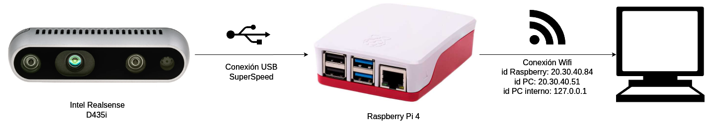
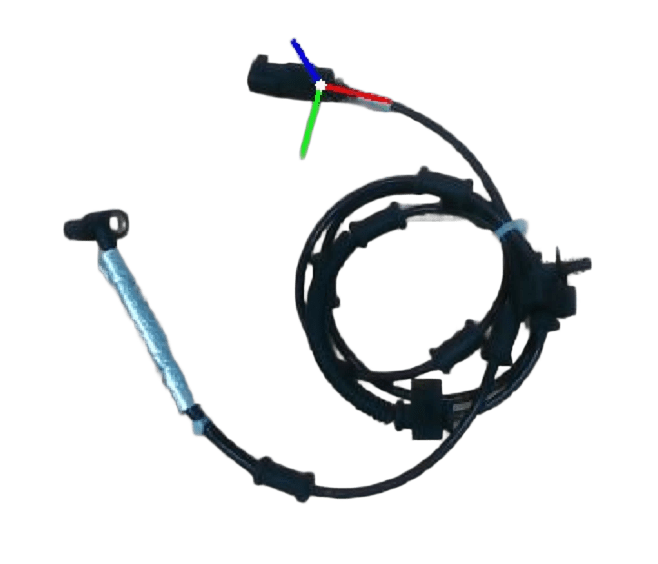
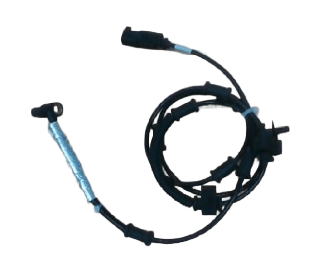

# 3D Cable Pose Estimation & Wireless Offload in ROS 2

A containerized **ROS 2 Humble** computer vision pipeline for real-time 3D cable detection and pose estimation using **YOLO**, **Intel RealSense D435I**, and **CycloneDDS**.

This project systematically benchmarks and optimizes image transport and inference across three deployment architectures—**Local USB**, **Wireless Edge Computing (Raspberry Pi 4)**, and **Wireless Computational Offload (RPi + Host PC)**—achieving a **>97% bandwidth reduction** via JPEG compression and sustaining **~43.7 FPS** over standard Wi-Fi.

---

## System Architecture

In the final **Wireless Offload** architecture, a Raspberry Pi 4 acts as a lightweight sensor node capturing and compressing RGB frames from the RealSense camera, while a Dockerized Host PC performs YOLO inference and 3D Ray-Plane Intersection pose estimation over **CycloneDDS Unicast**.



### Key Benchmark Results

| Architecture | Avg. YOLO Inference | Total Callback | Effective FPS | Output Bandwidth | Container CPU / RAM |
| :--- | :--- | :--- | :--- | :--- | :--- |
| **1. Local USB (Uncompressed)** | 28.0 – 40.0 ms | >40.0 ms | ~30.0 FPS *(saturated)* | ~24.0 – 27.4 MB/s | ~820% / — |
| **2. Local USB (Compressed)** | **~14.2 ms** | **~17.1 ms** | **~30.0 FPS** | **~625.0 KB/s** | 436.6% / 629.8 MiB |
| **3. Edge Computing (RPi + Wi-Fi)** | ~145.2 ms | ~153.1 ms | ~6.5 FPS | ~142.0 KB/s | 277.4% / 670.6 MiB |
| **4. Wi-Fi Offload (RPi $\rightarrow$ PC)** | **~15.6 ms** | **~22.2 ms** | **~43.7 FPS** | **~1.79 MB/s** | **306.2% / 487.0 MiB** |

---

## Target Use Case & Adapting to Other Applications

### Current Detection Task
The included detection node (`detector_node.py`) and pretrained YOLO weights are specifically designed and trained for an industrial automotive use case: **estimating the 3D position and orientation (direction) of the connector tip on a specific car sensor cable**.

Below is an example of the expected pose output alongside an unmarked reference image of the cable (which you can display or print in front of the camera to test the current node out of the box):

| Expected Pose Detection Output | Unmarked Reference Image (For Testing) |
| :---: | :---: |
|  |  |

### Reusing the Architectures for Custom Vision Applications
All four communication and deployment architectures (`cable_pose_usb`, `cable_pose_usb_compress`, `cable_pose_py`, and `cable_pose_offload`) are modular and can be reused as a template for **any other ROS 2 computer vision task**:

1. **Add your custom model:** Place your trained model weights (e.g., `.pt` file) inside the `models/` folder of the chosen package variant and update the model reference in `config/cables_params.yaml` if necessary.
2. **Customize the inference node:** Edit `detector_node.py` inside the corresponding package to adapt the pre-processing, inference parsing, post-processing, or published ROS 2 topics to your application's requirements.

The rest of the stack—Docker containers, JPEG compression pipeline, QoS profiles, and CycloneDDS Unicast Wi-Fi configuration—will work without further structural changes.

---

## Installation

1. **Install Docker Engine** (see [official Docker docs](https://docs.docker.com/engine/install/)) and ensure Docker Compose is available.

2. **Clone this repository**

```bash
mkdir -p ~/projects
cd ~/projects
git clone https://github.com/benatotaegi-ops/ros2-wifi-vision-validation.git
```

3. **Adapt local paths and network IPs**

   * Update the host volume path in `docker/docker-compose.yaml` to match where you cloned the repository (default: `~/projects/ros2-wifi-vision-validation/camera_adaptation_ws`).
   * For wireless/offload modes, update the Host PC and Raspberry Pi IP addresses in `docker/config/cyclone_dds_config.xml`.

4. **Make the launch and entrypoint scripts executable**

```bash
cd ~/projects/ros2-wifi-vision-validation/camera_adaptation_ws/src/cable_pose_yolo/<PACKAGE_VARIANT>/docker
chmod +x ./launch.bash ./config/entrypoint.bash
```

*(Replace `<PACKAGE_VARIANT>` with `cable_pose_usb`, `cable_pose_usb_compress`, `cable_pose_py`, or `cable_pose_offload`).*

5. **Build and launch the Docker container**

```bash
docker compose down --remove-orphans
docker compose up --build
```

---

## Documentation (`camera_adaptation_ws/doc/`)

All technical guides, hardware configurations, and experimental benchmarking reports are organized inside the `doc/` directory:

| Document | Description |
| :--- | :--- |
| [`user_guide.md`](camera_adaptation_ws/doc/user_guide.md) | Complete user manual, workspace structure, Docker deployment instructions, RQT visualization, and metrics extraction methodology. |
| [`raspberry_pi_offload_setup.md`](camera_adaptation_ws/doc/raspberry_pi_offload_setup.md) | Step-by-step setup guide for the Raspberry Pi 4 sensor edge node, including its Docker environment, CycloneDDS Unicast XML, and JPEG compressor node (`simple_compressor`). |
| [`conclusions_1_usb.md`](camera_adaptation_ws/doc/conclusions_1_usb.md) | Phase 1 validation report comparing uncompressed vs. JPEG-compressed pipelines (10 FPS throttled and 30 FPS full rate) over local USB. |
| [`conclusions_2_wifi.md`](camera_adaptation_ws/doc/conclusions_2_wifi.md) | Phase 2 benchmarking report comparing Local USB inference against Wireless Edge Computing directly on the Raspberry Pi 4. |
| [`conclusions_3_wifi_offload.md`](camera_adaptation_ws/doc/conclusions_3_wifi_offload.md) | Phase 3 final report evaluating the Wireless Offload architecture (RPi capture + PC inference) against both previous baselines. |
| [`camera_architecture_diagram.png`](camera_adaptation_ws/doc/camera_architecture_diagram.png) | Hardware and network connectivity diagram for the Intel RealSense D435I, Raspberry Pi 4, and Host PC. |

---

## Repository Overview

* **`camera_adaptation_ws/src/cable_pose_yolo/`**: Modular ROS 2 packages for each tested architecture (`cable_pose_usb`, `cable_pose_usb_compress`, `cable_pose_py`, `cable_pose_offload`).
* **`camera_adaptation_ws/doc/`**: Setup guides, architecture diagrams, sample cable images, and benchmarking conclusions.
* **`metrics/`**: Raw experimental logs (`bandwidth_output.log`, `latencies.log`, `docker_stats.txt`) recorded across 120-second test windows for reproducibility.

## Tech Stack

* **Robotics Middleware:** ROS 2 Humble, CycloneDDS (`rmw_cyclonedds_cpp`), `tf2_ros`, `image_transport`
* **Computer Vision & AI:** PyTorch, Ultralytics YOLO, OpenCV, `cv_bridge`, Intel RealSense SDK
* **Infrastructure:** Docker, Docker Compose, Linux (Ubuntu / Raspberry Pi OS)