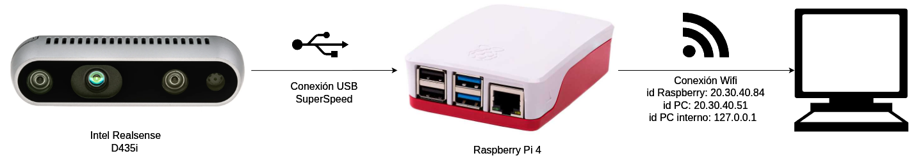

# ROS 2 Computer Vision User and Benchmarking Guide: 3D Cable Detection (`cable_pose_yolo`)

This document serves as the official user manual and methodological reference framework for deploying, configuring, and evaluating the performance of the YOLO-based 3D cable detection system (`cable_pose_yolo`) across different connectivity architectures (Local USB, Edge Computing on Raspberry Pi, and Remote Wi-Fi Offload).

## 1. System Overview and Architecture Variants

* **ROS 2 Distribution:** ROS 2 Humble

* **Communication Middleware (RMW):** CycloneDDS (`rmw_cyclonedds_cpp`)

* **ROS Domain:** `Domain ID = 87`

* **Sensor:** Intel RealSense D435I camera streaming RGB images and calibration data (`CameraInfo`).

* **Runtime Environment:** Docker container (`cable_pose_yolo`) configured in `network_mode: host`, performing inference via PyTorch/Ultralytics and 3D geometric computation using *Ray-Plane Intersection*.

**Hardware Diagram for Online Connection:**



```text
+--------------------------+          +--------------------------+          +---------------------------------+
|  Intel RealSense D435I   |          |      Raspberry Pi 4      |          |       Host PC (Docker)          |
|  (RGB Sensor + Calib.)   | =======> |  (Sensor Node + Compr.)  | - - - -> |  (YOLO Inference + 3D Pose)     |
+--------------------------+  USB 3.0 +--------------------------+  Wi-Fi   +---------------------------------+
                                           IP: 20.30.40.84          (DDS)            IP: 20.30.40.51
```

### Available Packages in the Workspace (`src/cable_pose_yolo/`)

The repository includes four modular variants depending on the desired test or deployment scenario:

1. **`cable_pose_usb`**: Local baseline configuration. The RealSense camera connects directly to the PC via USB and the stream is processed raw (`/cam_3/camera/color/image_raw`).

2. **`cable_pose_usb_compress`**: Optimized local variant using JPEG-compressed streams to reduce traffic over the ROS 2 bus.

3. **`cable_pose_py`**: Variant designed for direct execution testing or *Edge* deployment on a Raspberry Pi.

4. **`cable_pose_offload`**: Wireless distributed architecture (*Offload*). The Raspberry Pi captures and compresses images into JPEG (`/cam_3/camera/color/image_raw/compressed`), transmitting them over Wi-Fi with `Best Effort` QoS, while the Host PC runs heavy YOLO inference inside Docker.

## 2. Workspace Project Structure

Below is the clean repository structure (omitting auto-generated `build/`, `install/`, `log/`, and `__pycache__/` directories):

```
camera_adaptation_ws/
├── doc/
│   ├── camera_architecture_diagram.png
│   ├── conclusions_1_usb.md
│   ├── conclusions_2_wifi.md
│   ├── conclusions_3_wifi_offload.md
│   ├── raspberry_pi_offload_setup.md
│   └── user_guide.md
├── entrypoint.bash
└── src/
    └── cable_pose_yolo/
        ├── cable_pose_offload/
        │   ├── cable_pose_offload/
        │   │   ├── __init__.py
        │   │   └── detector_node.py
        │   ├── config/
        │   │   └── cables_params.yaml
        │   ├── docker/
        │   │   ├── config/
        │   │   │   ├── cables_params.yaml
        │   │   │   ├── cyclone_dds_config.xml
        │   │   │   ├── entrypoint.bash
        │   │   │   └── requirements.txt
        │   │   ├── docker-compose.yaml
        │   │   ├── Dockerfile
        │   │   ├── Dockerfile_headless
        │   │   └── launch.bash
        │   ├── launch/
        │   │   └── cable_pose_yolo.launch.py
        │   ├── models/
        │   │   └── cables_model.pt
        │   ├── package.xml
        │   ├── resource/
        │   │   └── cable_pose_offload
        │   ├── setup.cfg
        │   ├── setup.py
        │   └── test/
        ├── cable_pose_py/
        │   ├── cable_pose_py/
        │   │   ├── __init__.py
        │   │   └── detector_node.py
        │   ├── config/
        │   │   └── cables_params.yaml
        │   ├── docker/
        │   │   ├── config/
        │   │   ├── docker-compose.yaml
        │   │   ├── Dockerfile
        │   │   ├── Dockerfile_headless
        │   │   └── launch.bash
        │   ├── launch/
        │   │   └── cable_pose_yolo.launch.py
        │   ├── models/
        │   │   └── cables_model.pt
        │   ├── package.xml
        │   ├── resource/
        │   │   └── cable_pose_py
        │   ├── setup.cfg
        │   ├── setup.py
        │   └── test/
        ├── cable_pose_usb/
        │   ├── cable_pose_yolo/
        │   │   ├── __init__.py
        │   │   └── detector_node.py
        │   ├── config/
        │   │   └── cables_params.yaml
        │   ├── docker/
        │   │   ├── config/
        │   │   ├── docker-compose.yaml
        │   │   ├── Dockerfile
        │   │   ├── Dockerfile_headless
        │   │   └── launch.bash
        │   ├── launch/
        │   │   └── cable_pose_yolo.launch.py
        │   ├── models/
        │   │   └── cables_model.pt
        │   ├── package.xml
        │   ├── resource/
        │   │   └── cable_pose_yolo
        │   ├── setup.cfg
        │   ├── setup.py
        │   └── test/
        └── cable_pose_usb_compress/
            ├── cable_pose_yolo_compress/
            │   ├── __init__.py
            │   └── detector_node.py
            ├── compressed_version_changelog.md
            ├── config/
            │   └── cables_params.yaml
            ├── docker/
            │   ├── config/
            │   ├── docker-compose.yaml
            │   ├── Dockerfile
            │   ├── Dockerfile_headless
            │   └── launch.bash
            ├── launch/
            │   └── cable_pose_yolo.launch.py
            ├── models/
            │   └── cables_model.pt
            ├── package.xml
            ├── resource/
            ├── setup.cfg
            ├── setup.py
            └── test/

```

## 3. Prerequisites and Setup on New Devices

Before starting any of the containers on a new computer, **three parameters must be adapted** to the local machine:

### A. Adjust the Volume Path in `docker-compose.yaml`

Open the `docker/docker-compose.yaml` file of the variant you intend to run and make sure the path where you cloned the repository matches the volume mapping to `/app/camera_adaptation_ws`:

```
    volumes:
      - /tmp/.X11-unix:/tmp/.X11-unix
      - ./config/cyclone_dds_config.xml:/root/cyclone_dds_config.xml
      - ./config/entrypoint.bash:/app/camera_adaptation_ws/entrypoint.bash
      - ./config/cables_params.yaml:/app/camera_adaptation_ws/src/cable_pose_yolo/<PACKAGE>/config/cables_params.yaml
      - ~/projects/camera_adaptation/camera_adaptation_ws:/app/camera_adaptation_ws # <-- Adjust if cloned to a different path

```

### B. Configure IP Addresses in `cyclone_dds_config.xml` (Remote / Offload Mode)

If you are using a networked architecture (such as `cable_pose_offload`) with Multicast traffic disabled (`<AllowMulticast>false</AllowMulticast>`), edit `docker/config/cyclone_dds_config.xml` and update the IPs to match your devices:

```
<CycloneDDS xmlns="https://cdds.io/config" xmlns:xsi="http://www.w3.org/2001/XMLSchema-instance">
  <Domain id="any">
    <General>
      <Interfaces>
        <!-- IP of YOUR Host PC's Wi-Fi/Ethernet network interface -->
        <NetworkInterface address="20.30.40.51" />
      </Interfaces>
      <AllowMulticast>false</AllowMulticast>
    </General>
    <Discovery>
      <ParticipantIndex>auto</ParticipantIndex>
      <MaxAutoParticipantIndex>50</MaxAutoParticipantIndex>
      <Peers>
        <!-- IP of the sending Raspberry Pi -->
        <Peer address="20.30.40.84"/>
        <!-- MANDATORY: Include localhost and the PC's IP so Host and Docker can discover each other -->
        <Peer address="127.0.0.1"/>
        <Peer address="20.30.40.51"/>
      </Peers>
    </Discovery>
  </Domain>
</CycloneDDS>

```

*(Tip: Copy this same file to `$HOME/pc_dds.xml` on your Host PC so you can inspect topics from outside Docker).*

## 4. Startup Procedure (Dockerized Environment)

The entire system deployment is managed centrally via Docker Compose. The internal `entrypoint.bash` script automatically compiles the package with `colcon build`, launches the static transform (`tf2_ros`) between `auxiliar_table` and `camera_color_optical_frame`, and starts the detector node.

### Step 1: Start the Docker Container with Automatic Build

Navigate to the `docker` folder of the test you want to run (e.g., `cable_pose_usb`, `cable_pose_offload`, etc.) and start the container:

```
cd ~/projects/camera_adaptation/camera_adaptation_ws/src/cable_pose_yolo/<CHOSEN_TEST>/docker
docker compose down --remove-orphans
docker compose up --build

```

*(You can append the `-d` flag at the end, `docker compose up --build -d`, to start the container in detached mode without blocking the terminal with latency logs).*

### Step 2: Verify Node and Topic Communication on the Shared Bus

To verify that the RealSense camera topics and detector outputs (`/cam_3/cable_poses`, `/camera/color/image_annotated/compressed`, etc.) are flowing properly over the ROS 2 bus, you can query the container directly:

```
docker exec -it cable_pose_yolo bash -c "export ROS_DOMAIN_ID=87 && export RMW_IMPLEMENTATION=rmw_cyclonedds_cpp && source /opt/ros/humble/setup.bash && ros2 topic list"

```

Alternatively, check from a native terminal on your **Host PC** (outside Docker) by exporting the CycloneDDS configuration:

```
source /opt/ros/humble/setup.bash
export ROS_DOMAIN_ID=87
export RMW_IMPLEMENTATION=rmw_cyclonedds_cpp
export CYCLONEDDS_URI=file://$HOME/pc_dds.xml

ros2 daemon stop
ros2 topic list
ros2 topic echo /cam_3/cable_poses

```

### Step 3: Visual Inspection with RQT and Log Monitoring

* **2D Detection Viewer (Bounding Boxes, Keypoints, and 3D Axes):**
  To visually inspect YOLO inference results in real time by running the graphical interface connected to the shared bus:

  ```
  xhost +local:docker
  docker exec -it cable_pose_yolo bash -c "export ROS_DOMAIN_ID=87 && export RMW_IMPLEMENTATION=rmw_cyclonedds_cpp && export DISPLAY=\$DISPLAY && source /opt/ros/humble/setup.bash && ros2 run rqt_image_view rqt_image_view"
  
  ```

  *(Once the graphical interface opens, select the processed image topic, such as `/camera/color/image_annotated/compressed` or `/camera/color/image_annotated`, from the dropdown menu).*

* **Real-Time Log Monitoring (Inference and Callback Times):**

  ```
  docker logs cable_pose_yolo -f
  
  ```

## 5. Metrics Extraction Methodology

To perform an objective technical comparison across the different configurations, record the core metrics by first creating a target directory (for example, `local_usb` or `wifi_remote_compressed`):

```
mkdir -p ~/projects/camera_adaptation/metrics/<TARGET_FOLDER>

```

### A. Input Bandwidth (Bus/Network Load of Incoming Video)

Measures the stability and throughput of the incoming camera video stream (`/cam_3/camera/color/image_raw` in raw mode or `/cam_3/camera/color/image_raw/compressed` in compressed mode) over $120\text{ seconds}$:

```
timeout 120s bash -c "source /opt/ros/humble/setup.bash && export ROS_DOMAIN_ID=87 && export RMW_IMPLEMENTATION=rmw_cyclonedds_cpp && export CYCLONEDDS_URI=file://\$HOME/pc_dds.xml && ros2 topic bw /cam_3/camera/color/image_raw/compressed" > ~/projects/camera_adaptation/metrics/<TARGET_FOLDER>/bandwidth_input.log

```

### B. Output Bandwidth (Throughput of the Annotated / Processed Image)

Measures the network impact of transmitting the already processed video stream containing YOLO detections (`/camera/color/image_annotated/compressed`) to viewers or monitoring stations:

```
timeout 120s bash -c "source /opt/ros/humble/setup.bash && export ROS_DOMAIN_ID=87 && export RMW_IMPLEMENTATION=rmw_cyclonedds_cpp && export CYCLONEDDS_URI=file://\$HOME/pc_dds.xml && ros2 topic bw /camera/color/image_annotated/compressed" > ~/projects/camera_adaptation/metrics/<TARGET_FOLDER>/bandwidth_output.log

```

### C. Inference and Callback Latency

Extracts internal processing times (YOLO inference time vs. total callback time) directly from the running container logs:

```
docker logs cable_pose_yolo --tail 500 | grep "Inferencia YOLO" > ~/projects/camera_adaptation/metrics/<TARGET_FOLDER>/latencies.log

```

### D. Compute Resource Usage (CPU and RAM)

Monitors the performance impact on the host machine during execution using static Docker container statistics:

```
docker stats cable_pose_yolo --no-stream > ~/projects/camera_adaptation/metrics/<TARGET_FOLDER>/docker_stats.txt

```

## 6. Key Considerations and Troubleshooting

When migrating or running the system on other devices or wireless networks, keep the following engineering rules in mind:

1. **Bandwidth Saturation:** Uncompressed color images (`image_raw`) saturate standard Wi-Fi networks or cause massive packet loss. In remote architectures, it is mandatory to use compressed topics (`/image_raw/compressed`) together with `compressed_imgmsg_to_cv2` in OpenCV.

2. **Quality of Service (QoS) Consistency:** The publishing nodes on the Raspberry Pi publish both the image and `CameraInfo` in `Best Effort` mode. Therefore, subscriptions in `detector_node.py` must always use the `qos_profile_sensor_data` profile. If a standard numeric QoS (`10`) is used, the `CameraInfo` subscription will fail silently and the node will never process images because `self.intrinsics = None`.

3. **Topic Visibility Between Docker and Host in Unicast Mode:**

   * Never include `unset CYCLONEDDS_URI` inside `entrypoint.bash`, as it will desynchronize the container from the injected XML configuration.

   * If `<AllowMulticast>` is set to `false`, make sure to always include `<Peer address="127.0.0.1"/>` and the PC's local IP in the XML `<Peers>` list; otherwise, nodes inside Docker will be invisible to tools executed on the Host PC itself (`rqt`, `ros2 topic echo`).

4. **Time Synchronization:** In distributed deployments (Raspberry Pi + PC), both machines must be synchronized via **NTP** or **Chrony** to avoid temporal extrapolation failures in `tf2_ros` transforms.